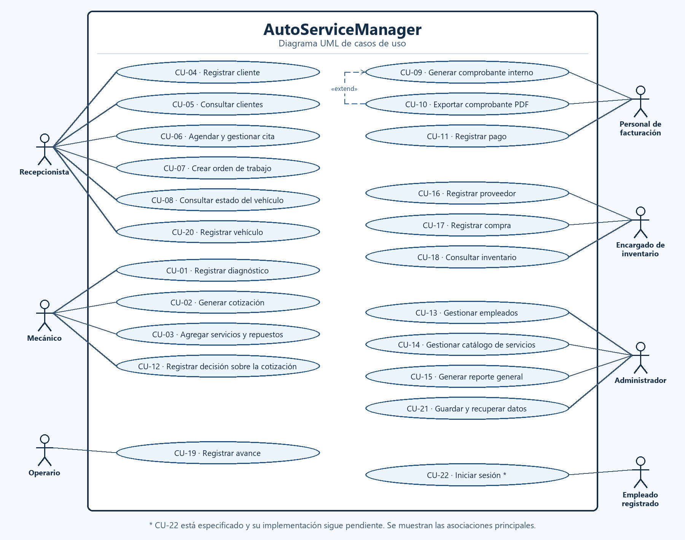

# Especificación de Requerimientos de Software de AutoServiceManager

**Versión 1.0 — Entrega académica final** · **Fecha:** 25/11/2026\
**Asignatura:** Diseño y Programación de Software · Escuela Politécnica Nacional\
**Equipo:** Joel Ordoñez, Ronald Veloz y Pablo Cuasapaz

Este SRS integra PPE03–PPE08 y establece 25 requerimientos analizados. La matriz de trazabilidad identifica el estado de implementación y las pruebas disponibles. La aprobación formal de la versión y la validación con interesados carecen de constancia.

## 1. Introducción

**Propósito.** Especificar el comportamiento de la aplicación de escritorio y dar al equipo una base para revisar alcance, implementación y pruebas.

**Alcance.** Gestión local de clientes y vehículos, citas, órdenes de trabajo, diagnóstico y seguimiento, inventario, servicios, personal, comprobantes, registro de pagos y reportes. La primera versión excluye aplicación móvil y web, reservas por Internet, pagos bancarios en línea, GPS, pedidos a sistemas externos y facturación tributaria electrónica. El comprobante de servicio PDF informa importes dentro de ese alcance.

| Término | Significado en este SRS |
|---|---|
| IR, SRS | Ingeniería de Requerimientos y Especificación de Requerimientos de Software. |
| RF, RNF, RD | Requerimiento funcional, no funcional y de dominio. |
| CU, HU, CP | Caso de uso, historia de usuario y caso de prueba propuesto. |
| INF, P, C | Registro de adquisición, aclaración y conflicto documentados en PPE04. |
| Orden de trabajo | Registro del servicio asociado al vehículo y a su propietario. |
| Cotización | Estimación de servicios y repuestos previa al trabajo. |
| Comprobante | Registro interno de cobro y, cuando se solicita, PDF informativo asociado a la orden. |
| IVA, SRI | Impuesto al valor agregado y Servicio de Rentas Internas. La aplicación usa una tasa configurable y excluye la autorización tributaria del comprobante. |

[Visión y alcance](01_Gestion_y_Alcance/01_Vision_y_Alcance.md)

## 2. Descripción general

El producto centraliza datos que un taller manejaría en registros manuales o dispersos. Recepción organiza citas y órdenes. Taller registra diagnóstico, cotización, consumo y avance. Inventario mantiene las existencias. Facturación emite el comprobante de servicio y registra el pago. Administración mantiene catálogos y produce información para el propietario.

| Interesado | Rol en el negocio | Relación con la aplicación |
|---|---|---|
| Propietario | Supervisa ingresos y operaciones. | Interno, indirecto. Recibe reportes preparados por Administración. |
| Administrador | Gestiona personal, servicios y reportes. | Interno, directo. |
| Recepcionista | Atiende clientes, agenda y recibe vehículos. | Interno, directo. |
| Mecánico y operación de taller | Realizan diagnóstico y reparación y registran su avance. | Interno, directo. |
| Encargado de inventario | Mantiene repuestos, proveedores y movimientos. | Interno, directo. |
| Personal de facturación | Registra el cobro y entrega el comprobante. | Interno, directo. |
| Cliente y proveedor | Reciben información o se relacionan con el taller. | Externos, indirectos en la aplicación. |
| Equipo de desarrollo | Desarrolla y verifica durante la asignatura. | Externo al taller, indirecto en la operación. |

**Restricciones.** Aplicación Windows Forms en C# y .NET 10, persistencia local SQLite, trabajo sin conexión permanente, sin infraestructura especializada ni servicios externos de pago, y calendario académico. La matriz de trazabilidad distingue las funciones implementadas de las que quedan por implementar.

**Adquisición.** Se documentan 15 registros derivados de escenarios, 12 aclaraciones y cuatro conflictos. Las fuentes de roles y respuestas son simuladas. La revisión también usa la visión, la matriz de interesados y el proyecto. Los conflictos C-01 a C-04 siguen pendientes de negociación acreditada.

[Matriz de interesados](01_Gestion_y_Alcance/02_Matriz_Interesados.md) · [Adquisición](02_Adquisicion_e_Interesados/01_Adquisicion_Requerimientos.md)

## 3. Requerimientos funcionales

### RF-01 · Registro y consulta de clientes

El sistema deberá permitir a Recepción registrar y localizar clientes por identificación con nombre, identificación y teléfono obligatorios, y correo y dirección opcionales.

- **Fuente:** Recepcionista · INF-01, P-01, C-01
- **Estado:** Analizado · **Prioridad:** Must
- **Dependencias:** Ninguna
- **Aceptación:** Con nombre, identificación y teléfono se guarda un cliente localizable por identificación aunque falten correo y dirección. Si falta un dato obligatorio, se identifica el campo y se impide el alta.
- **Verificación:** CU-04, CU-05 · CP-01

### RF-02 · Registro de vehículos

El sistema deberá permitir a Recepción registrar placa, marca, modelo y año de un vehículo asociado a un cliente registrado.

- **Fuente:** Administrador · INF-02, P-02
- **Estado:** Analizado · **Prioridad:** Must
- **Dependencias:** RF-01, RD-03
- **Aceptación:** El vehículo queda visible para su cliente con los cuatro datos; al indicar un cliente inexistente, el sistema rechaza el alta.
- **Verificación:** CU-20 · CP-02

### RF-03 · Gestión de citas

El sistema deberá permitir a Recepción gestionar altas, consultas, reprogramaciones y cancelaciones de citas con cliente, vehículo, fecha, hora y motivo, con un solo turno activo por fecha y hora en la agenda del taller.

- **Fuente:** Recepcionista · INF-03, P-03, C-04
- **Estado:** Analizado · **Prioridad:** Should
- **Dependencias:** RF-02
- **Aceptación:** El alta válida queda Programada y aparece en la agenda. Programada y Confirmada ocupan el turno. Recepción puede mover una cita activa a un turno libre conservando su estado o cancelarla para liberar su turno. Atendida y Cancelada cierran la cita.
- **Verificación:** CU-06 · CP-03

### RF-04 · Creación de órdenes de trabajo

El sistema deberá permitir a Recepción abrir una orden para un cliente y un vehículo registrados con al menos un servicio solicitado, con cita previa opcional.

- **Fuente:** Administrador · INF-05; alta sin cita en el catálogo anterior y HU-01
- **Estado:** Analizado · **Prioridad:** Must
- **Dependencias:** RF-10, RD-01
- **Aceptación:** Una orden válida queda en estado Recibido con o sin cita vinculada y muestra el servicio solicitado. Si se usa una cita pendiente del mismo cliente y vehículo, pasa a Atendida. Se rechaza una orden sin cliente, vehículo o servicio solicitado.
- **Verificación:** CU-07 · CP-04

### RF-05 · Consulta de estado e historial por placa

El sistema deberá mostrar el estado actual y el historial de órdenes y servicios de un vehículo identificado por su placa.

- **Fuente:** Mecánico · INF-04, INF-07, P-04
- **Estado:** Analizado · **Prioridad:** Should
- **Dependencias:** RF-04, RF-06
- **Aceptación:** Para una placa con órdenes se muestra primero la más reciente y su estado, con acceso a los servicios de cada orden. Para una placa sin órdenes se indica que no tiene historial.
- **Verificación:** CU-08 · CP-05

### RF-06 · Registro del avance de una orden

El sistema deberá permitir a Mecánico u Operario registrar el avance de una orden activa con una observación y el estado Recibido, En diagnóstico, En reparación, Listo para entrega o Entregado.

- **Fuente:** Mecánico · INF-07, P-06 y C-02. Secuencia refinada en PPE05.
- **Estado:** Analizado · **Prioridad:** Should
- **Dependencias:** RF-04
- **Aceptación:** Al guardar una observación, la orden conserva su estado o avanza a uno posterior en la secuencia Recibido → En diagnóstico → En reparación → Listo para entrega → Entregado. El avance queda visible en el historial. El sistema rechaza un retroceso o un nuevo avance sobre una orden Entregada.
- **Verificación:** CU-19 · CP-06

### RF-07 · Consulta y actualización de inventario

El sistema deberá permitir al Encargado de inventario mantener el catálogo y las existencias de repuestos con código, descripción, cantidad disponible y precio referencial.

- **Fuente:** Encargado de inventario · INF-08, INF-09, P-07
- **Estado:** Analizado · **Prioridad:** Must
- **Dependencias:** Ninguna
- **Aceptación:** Al dar de alta un repuesto se muestran código, descripción, cantidad y precio. Después de registrar un movimiento válido, el listado refleja la existencia resultante.
- **Verificación:** CU-17, CU-18 · CP-07

### RF-08 · Generación del comprobante en PDF

El sistema deberá permitir al Personal de facturación exportar en PDF el comprobante de una orden con partidas y subtotal mayor que cero.

- **Fuente:** Personal de facturación · INF-13, P-10; Visión §2.2
- **Estado:** Analizado · **Prioridad:** Should
- **Dependencias:** RF-04, RD-02
- **Aceptación:** Con una orden con partidas y subtotal mayor que cero se genera un PDF con sus partidas, valores y campos de RD-02. Si faltan partidas o el subtotal es cero, se informa la causa y no se genera el PDF.
- **Verificación:** CU-09, CU-10 · CP-08

### RF-09 · Gestión de empleados

El sistema deberá permitir a Administración registrar, consultar y actualizar empleados con nombre, identificación, teléfono y rol requeridos.

- **Fuente:** Administrador · Visión §2.1.7 y Matriz PPE03; insumo de PPE04 F-DOC
- **Estado:** Analizado · **Prioridad:** Should
- **Dependencias:** Ninguna
- **Aceptación:** El alta aparece en el listado con la identificación y el rol elegidos. Al modificar teléfono o rol, la consulta posterior muestra el cambio conservando la identificación.
- **Verificación:** CU-13 · CP-09

### RF-10 · Gestión del catálogo de servicios

El sistema deberá permitir a Administración registrar, consultar y actualizar los servicios del catálogo con nombre y precio referencial mayor que cero.

- **Fuente:** Administrador · Visión §2.1.7 y F-DOC; INF-11/P-09 sustentan los costos de cotización de forma indirecta
- **Estado:** Analizado · **Prioridad:** Must
- **Dependencias:** Ninguna
- **Aceptación:** El servicio aparece en el catálogo y al editar su precio se muestra el nuevo valor. Se rechaza un precio cero o negativo sin guardar ni modificar la ficha.
- **Verificación:** CU-14 · CP-15

### RF-11 · Reporte administrativo

El sistema deberá permitir a Administración generar un reporte con número de órdenes por estado, total de pagos registrados y stock disponible por repuesto.

- **Fuente:** Propietario · INF-14 y P-11. El desglose de stock se deriva de INF-08.
- **Estado:** Analizado · **Prioridad:** Could
- **Dependencias:** RF-04, RF-07, RF-14
- **Aceptación:** El reporte reproduce el conteo agrupado de órdenes, la suma de pagos y la existencia de cada repuesto para el mismo conjunto de datos.
- **Verificación:** CU-15 · CP-16

### RF-12 · Diagnóstico y gestión de cotizaciones

El sistema deberá permitir al Mecánico gestionar la cotización de una orden con su diagnóstico, costos estimados y decisión comunicada por el cliente.

- **Fuente:** Mecánico y Administrador · INF-06, P-05, INF-11 y P-09. El registro de la decisión procede de HU-03, CU-12 y la operación existente del módulo de taller.
- **Estado:** Analizado · **Prioridad:** Must
- **Dependencias:** RF-04, RF-07, RF-10
- **Aceptación:** El diagnóstico contiene fallas, observaciones y trabajos recomendados. La cotización parte de al menos un servicio del catálogo, suma servicios y repuestos estimados, y conserva el stock. Un diagnóstico vacío impide emitirla. La emisión queda Pendiente. Mecánica registra la decisión del cliente como Aprobada o Rechazada. Cancelar el diálogo conserva el estado de la cotización.
- **Verificación:** CU-01, CU-02, CU-03 (servicios), CU-12 · CP-17

### RF-13 · Consumo de repuestos en una orden

El sistema deberá permitir a Mecánico registrar en una orden el consumo de una cantidad entera positiva de un repuesto disponible con descuento de esa cantidad del inventario.

- **Fuente:** Encargado de inventario · INF-09, P-07, C-03
- **Estado:** Analizado · **Prioridad:** Must
- **Dependencias:** RF-04, RF-07
- **Aceptación:** Si hay stock suficiente, la orden incorpora la partida y el stock disminuye en la cantidad indicada. Si la cantidad es cero, negativa o superior al stock, se informa la causa y ambos registros quedan intactos.
- **Verificación:** CU-03 · CP-18

### RF-14 · Registro local de pagos

El sistema deberá permitir al Personal de facturación registrar un pago local asociado a una orden por un monto positivo que no supere su saldo pendiente.

- **Fuente:** Personal de facturación · INF-12, P-10
- **Estado:** Analizado · **Prioridad:** Must
- **Dependencias:** RF-04
- **Aceptación:** Un pago parcial reduce el saldo y un pago por el saldo lo lleva a cero. Un monto inválido se rechaza sin registrar pago. La exportación del PDF no es una precondición.
- **Verificación:** CU-11; CU-09 de soporte · CP-19

### RF-15 · Registro de proveedores

El sistema deberá permitir al Encargado de inventario registrar un proveedor con nombre, teléfono y correo electrónico para consulta local.

- **Fuente:** Encargado de inventario · INF-10, P-08
- **Estado:** Analizado · **Prioridad:** Could
- **Dependencias:** Ninguna
- **Aceptación:** Un proveedor ingresado con los tres datos aparece en el listado. Un campo obligatorio vacío impide el alta. El alta no genera pedidos externos.
- **Verificación:** CU-16 · CP-20

### RF-16 · Inicio de sesión de empleados

El sistema deberá permitir a un empleado registrado iniciar sesión con su cuenta y acceder al panel asociado al rol asignado.

- **Fuente:** Derivado de RNF-02 · Informe PPE05 §A y matriz de interesados. La validación con interesados consta como pendiente en PPE08.
- **Estado:** Analizado · **Prioridad:** Should
- **Dependencias:** RF-09
- **Aceptación:** Una cuenta habilitada con credenciales correctas abre el panel con su rol. Un usuario o contraseña incorrectos dejan el panel cerrado y muestran un error.
- **Verificación:** CU-22 · CP-21

## 4. Requerimientos no funcionales

### RNF-01 · Tiempo de respuesta del historial

El sistema deberá mostrar el historial solicitado por placa en un máximo de tres segundos desde que se elige la consulta.

- **Fuente:** INF-04, INF-07 y P-04 fundamentan la consulta. El catálogo PPE05 fija el umbral de tres segundos.
- **Estado:** Analizado · **Prioridad:** Should
- **Dependencias:** RF-05
- **Aceptación:** Cada una de cinco consultas muestra el historial o el aviso de ausencia dentro de tres segundos. La comprobación usa Windows con el runtime .NET 10 y una base sintética con 100 órdenes y 20 vehículos, uno sin órdenes. Se registra el equipo utilizado.
- **Verificación:** CU-08 · CP-10

### RNF-02 · Control de acceso por rol

El sistema deberá aplicar a cada función protegida los permisos del rol activo según la tabla de acceso de PPE06.

- **Fuente:** Administrador · Matriz PPE03 y F-DOC. La tabla de acceso se deriva de los actores asociados a cada caso de uso.
- **Estado:** Analizado · **Prioridad:** Should
- **Dependencias:** RF-16
- **Aceptación:** Cada función de la tabla de acceso se abre con el rol habilitado. Con un rol distinto queda bloqueada y se muestra Acceso denegado. Sin sesión, el sistema solicita la autenticación de RF-16.
- **Verificación:** CU-01 a CU-21, según la tabla de acceso, y CU-22 para el inicio de sesión · CP-11

### RNF-03 · Operación local y persistencia

El sistema deberá operar sin conexión a Internet con conservación de las operaciones confirmadas ante un cierre inesperado de la aplicación.

- **Fuente:** Administrador · INF-15, P-12, Visión §3.2
- **Estado:** Analizado · **Prioridad:** Must
- **Dependencias:** Ninguna
- **Aceptación:** Con Windows desconectado, el recorrido de cada módulo incluido en la versión permite terminar las operaciones sin errores de conexión. Tras forzar el cierre después de confirmar un registro, el registro sigue visible al reabrir.
- **Verificación:** Transversal · CP-12

### RNF-04 · Almacenamiento SQLite y respaldo

El sistema deberá mantener los datos en SQLite local y reservar a Administración la generación de copias de seguridad en una ruta seleccionada.

- **Fuente:** Administrador · INF-15, P-12, Visión §3.2
- **Estado:** Analizado · **Prioridad:** Should
- **Dependencias:** RNF-02
- **Aceptación:** Una sesión autorizada selecciona un destino y crea un archivo SQLite abrible con los datos confirmados al momento de la copia; una sesión sin permiso no puede iniciarla.
- **Verificación:** CU-21 · CP-22

### RNF-05 · Validación de formularios

El sistema deberá identificar el campo obligatorio vacío o inválido al intentar guardar un formulario y preservar el contenido previamente guardado ante el rechazo.

- **Fuente:** Recepcionista y Mecánico · C-01, C-02, INF-01/02/06/07
- **Estado:** Analizado · **Prioridad:** Should
- **Dependencias:** Ninguna
- **Aceptación:** Un teléfono obligatorio vacío, un año inválido y un importe inválido quedan identificados en el formulario correspondiente, por mensaje o restricción visible del control. Ningún intento inválido altera los datos persistidos.
- **Verificación:** CU-04, CU-11, CU-19, CU-20 · CP-23

### RNF-06 · Entorno Windows de escritorio

El sistema deberá ejecutarse como aplicación de escritorio Windows sobre .NET 10 sin depender de servicios externos de pago.

- **Fuente:** Equipo · Visión §§3.1 y 3.3; F-DOC, F-TEC para el soporte técnico
- **Estado:** Analizado · **Prioridad:** Must
- **Dependencias:** Ninguna
- **Aceptación:** En un equipo Windows con el runtime requerido se abre la aplicación y se completa el alta de un cliente con datos válidos sin contratar ni configurar un servicio externo de pago.
- **Verificación:** Transversal · CP-24

## 5. Requerimientos de dominio

### RD-01 · Asociación de la orden al cliente y vehículo

El sistema deberá asociar cada orden de trabajo a un vehículo registrado y al cliente registrado como propietario de ese vehículo.

- **Fuente:** Administrador · INF-02, INF-05; Recepción opera CU-07
- **Estado:** Analizado · **Prioridad:** Must
- **Dependencias:** RF-02
- **Aceptación:** Una orden válida muestra la placa y el cliente del vehículo. La creación con un cliente inexistente o con una placa asociada a otro cliente se rechaza.
- **Verificación:** CU-07 · CP-13

### RD-02 · Contenido del comprobante de servicio

El sistema deberá incluir en el PDF número, fecha, datos del cliente y vehículo, detalle de servicios y repuestos, subtotal, IVA, total y la leyenda «Documento sin validez tributaria».

- **Fuente:** Personal de facturación · INF-13, P-10, Visión §2.2.7; detalle refinado en PPE05/06
- **Estado:** Analizado · **Prioridad:** Should
- **Dependencias:** Ninguna
- **Aceptación:** El documento presenta los campos enumerados y la leyenda visible. Con una tasa configurada para el ensayo, el total coincide con la suma del subtotal y el IVA redondeado a centavos.
- **Verificación:** CU-09, CU-10 · CP-14

### RD-03 · Placa única por vehículo

El sistema deberá identificar cada vehículo por una placa única en el sistema y admitir varios vehículos con placas distintas para el mismo cliente.

- **Fuente:** Administrador · INF-02, P-02
- **Estado:** Analizado · **Prioridad:** Must
- **Dependencias:** Ninguna
- **Aceptación:** Una placa existente se rechaza como alta nueva, incluso si cambia el uso de mayúsculas o los espacios exteriores. Dos placas distintas pueden asociarse al mismo cliente.
- **Verificación:** CU-20 · CP-25

### Tabla de acceso por rol

| Rol habilitado | Funciones protegidas | Casos de uso |
| --- | --- | --- |
| Recepcionista | Clientes, vehículos, citas, órdenes e historial por placa. | CU-04, CU-05, CU-06, CU-07, CU-08 y CU-20 |
| Mecánico | Diagnóstico, cotización, decisión del cliente, partidas de servicios y repuestos y avance de órdenes. | CU-01, CU-02, CU-03, CU-12 y CU-19 |
| Operario | Registro de avances de la orden. | CU-19 |
| Encargado de inventario | Catálogo y existencias de repuestos, proveedores y entradas por compra. | CU-16, CU-17 y CU-18 |
| Personal de facturación | Comprobante interno, exportación a PDF y registro de pagos. | CU-09, CU-10 y CU-11 |
| Administrador | Empleados, catálogo de servicios, reportes y copias de seguridad. | CU-13, CU-14, CU-15 y CU-21 |

CU-22 está disponible sin sesión para que el empleado pueda autenticarse. El rol activo se obtiene de la cuenta asociada al empleado. RNF-02 protege las funciones aunque se intente acceder a ellas desde otra pantalla.

[Catálogo completo](03_Catalogo_y_Refinamiento/01_Catalogo_Requerimientos.md) · [Análisis y cambios](03_Catalogo_y_Refinamiento/02_Informe_Analisis_Refinamiento.md) · [Fichas de requisitos](04_Requerimientos_Verificables/01_Requerimientos_Refinados.md)

## 6. Modelo de casos de uso

| Actor | Tipo | Rol |
| --- | --- | --- |
| Recepcionista | Persona | Registra clientes, vehículos, citas y órdenes. Comunica el estado al cliente. |
| Mecánico | Persona | Registra diagnóstico, prepara la cotización y añade partidas. |
| Operario | Persona | Actualiza el avance de la orden. Un mecánico puede desempeñar este rol. |
| Encargado de inventario | Persona | Consulta existencias y registra entradas y proveedores. |
| Personal de facturación | Persona | Emite comprobantes y registra pagos comunicados o recibidos en el taller. |
| Administrador | Persona | Mantiene personal, servicios y reportes, y genera respaldos. |
| Empleado registrado | Persona | Inicia sesión para ejercer las funciones del rol asignado. |

| ID | Nombre | Actor principal | Requerimientos asociados | Propósito |
| --- | --- | --- | --- | --- |
| CU-01 | Registrar diagnóstico | Mecánico | RF-12, RNF-02 | Guarda las fallas, observaciones y trabajos recomendados para cotizar una orden. |
| CU-02 | Generar cotización | Mecánico | RF-12, RNF-02 | Prepara el estimado para comunicarlo al cliente. |
| CU-03 | Agregar servicios y repuestos | Mecánico | RF-12 (servicios de la cotización), RF-13, RNF-02 | Selecciona partidas de la orden y registra el consumo de repuestos. |
| CU-04 | Registrar cliente | Recepcionista | RF-01, RNF-05, RNF-02 | Da de alta al cliente con sus datos de identificación y contacto. |
| CU-05 | Consultar clientes | Recepcionista | RF-01, RNF-02 | Localiza un cliente por su identificación. |
| CU-06 | Agendar y gestionar cita | Recepcionista | RF-03, RNF-02 | Programa, consulta, reprograma o cancela citas según disponibilidad. |
| CU-07 | Crear orden de trabajo | Recepcionista | RF-04, RD-01, RNF-02 | Recibe el vehículo para un servicio con cita opcional. |
| CU-08 | Consultar estado del vehículo | Recepcionista | RF-05, RNF-01, RNF-02 | Consulta por placa el estado y el historial. El cliente recibe el resultado a través del personal. |
| CU-09 | Generar comprobante interno | Personal de facturación | RF-08, RF-14 (soporte), RD-02, RNF-02 | Calcula y guarda los importes del cobro. Conserva el caso antes denominado Generar factura. |
| CU-10 | Exportar comprobante PDF | Personal de facturación | RF-08, RD-02, RNF-02 | Exporta y revisa el comprobante local. Conserva el caso antes denominado Generar factura PDF. |
| CU-11 | Registrar pago | Personal de facturación | RF-14, RNF-05, RNF-02 | Registra el monto recibido por el taller y actualiza el saldo. |
| CU-12 | Registrar decisión sobre la cotización | Mecánico | RF-12, RNF-02 | Registra la decisión comunicada por el cliente en la cotización asociada a la orden. |
| CU-13 | Gestionar empleados | Administrador | RF-09, RNF-02 | Registra, consulta y actualiza personal y rol. |
| CU-14 | Gestionar catálogo de servicios | Administrador | RF-10, RNF-02 | Mantiene las fichas y precios referenciales del catálogo. |
| CU-15 | Generar reporte general | Administrador | RF-11, RNF-02 | Prepara el reporte operativo para la gerencia del taller. |
| CU-16 | Registrar proveedor | Encargado de inventario | RF-15, RNF-02 | Registra los datos básicos del proveedor. |
| CU-17 | Registrar compra | Encargado de inventario | RF-07 (soporte), RNF-02 | Registra una entrada de repuestos para el control de existencias. Caso de soporte de RF-07, sin integrar pedidos externos. |
| CU-18 | Consultar inventario | Encargado de inventario | RF-07, RNF-02 | Localiza repuestos y consulta precios y existencias. |
| CU-19 | Registrar avance | Operario | RF-06, RNF-05, RNF-02 | Guarda la observación y el estado de la orden. Un mecánico puede cumplir este rol en el flujo. |
| CU-20 | Registrar vehículo | Recepcionista | RF-02, RNF-05, RD-03, RNF-02 | Vincula la placa y los datos del vehículo al cliente propietario. |
| CU-21 | Guardar y recuperar datos | Administrador | RNF-04, RNF-02 | Crea una copia SQLite y comprueba su apertura en una ejecución con datos alternativos. |
| CU-22 | Iniciar sesión | Empleado registrado | RF-16, RNF-02 | Inicia una sesión con su cuenta y su rol. RF-16 consta en el alcance y su implementación sigue pendiente. |

CU-10 extiende CU-09 si se solicita el PDF. El cliente interviene a través del personal. CU-12 forma parte del ciclo de la cotización. CU-22 modela el inicio de sesión, cuya implementación sigue pendiente. RNF-03 y RNF-06 se aplican a toda la solución.

### Escenario detallado de CU-07 · Crear orden de trabajo

**Actor principal:** Recepcionista. **Requisitos:** RF-04 y RD-01. **Historia:** HU-01. **Prueba:** CP-04 y CP-13.

**Precondiciones.** La persona que registra la orden tiene una sesión con rol Recepcionista. El catálogo ya contiene al menos un servicio.

1. Recepción abre la opción Crear orden y busca al cliente por su identificación.
2. Selecciona el cliente y un vehículo registrado a su nombre.
3. El sistema muestra las citas pendientes del vehículo. Recepción vincula una cita del mismo cliente y vehículo cuando corresponda.
4. Recepción selecciona al menos un servicio solicitado y confirma el registro.
5. El sistema verifica cliente, vehículo y servicio. Si hay cita, verifica su asociación y estado.
6. El sistema guarda la orden, asigna el identificador y muestra el estado Recibido. Si se vinculó una cita, la deja Atendida.
7. Recepción verifica la confirmación y encuentra la orden en la lista por placa.

**Flujos alternativos.**

- A1 · Cliente inexistente en el paso 1. Recepción completa CU-04 y vuelve a buscar al cliente. Si cancela el alta, termina sin crear la orden.
- A2 · Vehículo inexistente en el paso 2. Recepción completa CU-20 para ese cliente y vuelve a seleccionarlo. Si la placa pertenece a otro cliente, el sistema informa el conflicto y no guarda la orden.
- A3 · Atención sin cita en el paso 3. Recepción continúa al paso 4 con el vínculo vacío.
- A4 · Sin servicio o cita incompatible en el paso 5. El sistema identifica la causa y vuelve al paso que permita corregirla. No guarda la orden ni cambia la cita.

**Postcondiciones.** En el flujo exitoso queda una orden vinculada al cliente y al vehículo. Un fallo de validación deja la orden sin crear y la cita sin cambios.

[Modelo de casos de uso](05_Modelado_y_Priorizacion/01_Modelo_Casos_Uso.md)

## 7. Historias de usuario y criterios de aceptación

### HU-01 · Crear orden de trabajo

**Requerimientos:** RF-04, RD-01; RF-02 y RD-03 para el alta previa; RNF-05 para validación.\
**Casos de uso:** CU-07, CU-20.\
**Historia:** Como recepcionista, quiero crear una orden con o sin cita, para registrar la recepción del vehículo y el servicio solicitado.

- **Dado que** el cliente y el vehículo están registrados y se selecciona un servicio, **cuando** confirmo la creación sin cita, **entonces** la nueva orden queda asociada a la placa y figura como Recibido.
- **Dado que** hay una cita pendiente del mismo cliente y vehículo, **cuando** la vinculo y confirmo una orden válida, **entonces** la orden queda vinculada y la cita se marca Atendida.
- **Dado que** falta un servicio o la placa corresponde a otro cliente, **cuando** intento guardar la orden, **entonces** se identifica la condición y el sistema no guarda la orden.

### HU-02 · Registrar diagnóstico y generar cotización

**Requerimientos:** RF-12, RF-10 y RF-13.\
**Casos de uso:** CU-01, CU-02, CU-03 y CU-14.\
**Historia:** Como mecánico, quiero registrar el diagnóstico y preparar una cotización, para explicar al cliente el trabajo y su costo previsto.

- **Dado que** hay una orden, un diagnóstico con fallas, observaciones y trabajos recomendados, y un servicio del catálogo, **cuando** genero la cotización, **entonces** se guarda el diagnóstico y el total suma los servicios y repuestos estimados, con stock intacto.
- **Dado que** el diagnóstico está vacío, **cuando** intento generar la cotización, **entonces** se indica qué dato debe completar el mecánico y la cotización no se guarda.
- **Dado que** el trabajo usa dos unidades de un repuesto con stock cinco, **cuando** registro por separado el consumo efectivo, **entonces** se añade el repuesto a la orden y quedan tres unidades.

### HU-03 · Registrar aprobación o rechazo de la cotización

**Requerimientos:** RF-12 · Diagnóstico y gestión de cotizaciones.\
**Casos de uso:** CU-12.\
**Historia:** Como cliente, quiero que el mecánico registre la decisión que le comunico sobre la cotización, para dejar constancia de si autorizo la reparación.

- **Dado que** existe una cotización pendiente y el cliente comunica que la aprueba, **cuando** el mecánico confirma el registro de aprobación, **entonces** se conserva la decisión Aprobada.
- **Dado que** existe una cotización pendiente y el cliente comunica que la rechaza, **cuando** el mecánico confirma el registro de rechazo, **entonces** se conserva la decisión Rechazada.
- **Dado que** el mecánico abrió la confirmación y la cierra o pulsa No a la confirmación de guardar, **cuando** vuelve al detalle de la orden, **entonces** la cotización conserva su estado.

### HU-04 · Registrar el avance de reparación

**Requerimientos:** RF-06 y RNF-05.\
**Casos de uso:** CU-19.\
**Historia:** Como operario de taller, quiero guardar una observación y el estado de una orden activa, para mantener visible el avance del trabajo.

- **Dado que** hay una orden activa y dispongo de una observación, **cuando** guardo el avance con el estado En reparación, **entonces** el historial muestra la observación y la orden muestra el estado actualizado.
- **Dado que** la orden ya está Entregada, **cuando** intento guardar otro avance, **entonces** la aplicación impide el cambio y conserva el historial previo.

### HU-05 · Generar comprobante y registrar pago

**Requerimientos:** RF-08, RF-14 y RD-02.\
**Casos de uso:** CU-09, CU-10, CU-11.\
**Historia:** Como integrante de facturación, quiero registrar pagos y exportar el comprobante de una orden, para informar al cliente los importes, los pagos y el saldo.

- **Dado que** la orden tiene un saldo de 100, **cuando** registro un pago de 30 y luego uno de 70, **entonces** el saldo pasa primero a 70 y luego a cero; ambas operaciones se permiten aunque todavía no exista un PDF.
- **Dado que** el importe supera el saldo o carece de un valor válido, **cuando** intento registrar el pago, **entonces** el sistema informa el problema y conserva el saldo.
- **Dado que** la orden tiene partidas por un subtotal mayor que cero, **cuando** exporto el comprobante, **entonces** el archivo muestra número, fecha, cliente, vehículo, partidas, subtotal, IVA configurado, total y la leyenda de RD-02.

[Historias de usuario](05_Modelado_y_Priorizacion/03_Historias_Usuario.md)

## 8. Matriz de priorización MoSCoW

| ID | Requerimiento | Prioridad | Justificación |
| --- | --- | --- | --- |
| RF-01 | Registro y consulta de clientes | Must | Base de atención y asociación de vehículos. |
| RF-02 | Registro de vehículos | Must | Identifica el vehículo antes de recibir el trabajo. |
| RF-03 | Gestión de citas | Should | La orden admite atención sin cita. |
| RF-04 | Creación de órdenes de trabajo | Must | Es el registro central del trabajo y cobro. |
| RF-05 | Consulta de estado e historial por placa | Should | Apoya el seguimiento diario del taller. |
| RF-06 | Registro del avance de una orden | Should | El trabajo puede ingresar antes de habilitar el seguimiento completo. |
| RF-07 | Consulta y actualización de inventario | Must | Proporciona las existencias que usa RF-13. |
| RF-08 | Generación del comprobante en PDF | Should | Entrega el comprobante; el cobro interno puede registrarse antes. |
| RF-09 | Gestión de empleados | Should | Se entrega antes del inicio de sesión que depende del registro de personal. |
| RF-10 | Gestión del catálogo de servicios | Must | RF-12 requiere servicios y precios de referencia. |
| RF-11 | Reporte administrativo | Could | Es análisis administrativo después de estabilizar los módulos fuente. |
| RF-12 | Diagnóstico y gestión de cotizaciones | Must | La cotización comunica el costo antes del trabajo. |
| RF-13 | Consumo de repuestos en una orden | Must | Evita desajustes de inventario durante el trabajo. |
| RF-14 | Registro local de pagos | Must | Es la operación central del cobro. |
| RF-15 | Registro de proveedores | Could | Es apoyo del inventario; puede programarse después del control de stock. |
| RF-16 | Inicio de sesión de empleados | Should | La prioridad coincide con la del control de acceso dependiente. |
| RNF-01 | Tiempo de respuesta del historial | Should | Es una meta de calidad del seguimiento. |
| RNF-02 | Control de acceso por rol | Should | Se verifica una vez disponible RF-16. |
| RNF-03 | Operación local y persistencia | Must | Sostiene la operación cotidiana del taller. |
| RNF-04 | Almacenamiento SQLite y respaldo | Should | Aporta recuperación ante pérdida del archivo de trabajo. |
| RNF-05 | Validación de formularios | Should | Reduce errores de captura en el taller. |
| RNF-06 | Entorno Windows de escritorio | Must | Define el entorno de ejecución de la primera versión. |
| RD-01 | Asociación de la orden al cliente y vehículo | Must | Asegura la integridad del historial. |
| RD-02 | Contenido del comprobante de servicio | Should | Protege la claridad del comprobante dentro del alcance de PPE03. |
| RD-03 | Placa única por vehículo | Must | Evita duplicidad de expedientes y sostiene el historial. |

### Negociación y planificación

| Conflicto | Solución técnica incorporada en la entrega | Requerimientos | Coordinación interna asignada | Ratificación de interesados |
|---|---|---|---|---|
| C-01 · Detalle de registros | Nombre, identificación y teléfono son obligatorios para clientes. Correo y dirección pueden omitirse en el alta. En vehículos se conservan placa, marca, modelo, año y propietario registrado. | RF-01, RF-02, RNF-05 | Joel Ordoñez | Sin constancia |
| C-02 · Tiempo de registro de avances | Se guarda la observación y el estado de la orden. La secuencia de RF-06 admite observaciones en el mismo estado y cierra en Entregado. Los importes de mano de obra se gestionan como partidas. | RF-04, RF-05, RF-06, RF-12 | Ronald Veloz | Sin constancia |
| C-03 · Control de repuestos | Inventario registra entradas. Mecánica estima repuestos en la cotización y descuenta existencias al registrar el consumo en la orden. | RF-07, RF-12, RF-13 | Pablo Cuasapaz | Sin constancia |
| C-04 · Funciones en línea | Recepción opera la agenda del taller. Programada y Confirmada ocupan el turno. La consulta y comunicación con el cliente se realizan por medio del personal. | RF-03, RF-05, RNF-03 | Joel Ordoñez | Sin constancia |

Las soluciones resuelven el alcance de la especificación académica a partir de los conflictos simulados de PPE04. La coordinación asignada identifica la responsabilidad documental. El estado de ratificación se consigna en el control de versiones.

| Iteración | Alcance | Orden de trabajo |
|---|---|---|
| I1 · Operación básica | RF-01, RF-02, RF-04, RF-07, RF-10, RF-12, RF-13, RF-14, RNF-03, RNF-06, RD-01, RD-03 | Establecer el entorno, clientes, vehículos y catálogos. Después habilitar órdenes, cotización, consumo y pagos. |
| I2 · Agenda, seguimiento y administración | RF-03, RF-05, RF-06, RF-08, RF-09, RF-16, RNF-01, RNF-02, RNF-04, RNF-05, RD-02 | Implementar RF-09 antes de RF-16 y RNF-02. Aplicar RNF-02 antes de restringir el respaldo. Implementar RF-06 antes de RF-05 y medir RNF-01 después. Completar RD-02 antes de aceptar el PDF. |
| I3 · Complementos | RF-11, RF-15 | Consolidar el reporte con datos reales de los módulos y habilitar el registro de proveedores. Verificar CU-17 con un proveedor registrado. |

I1 comprueba RF-07 mediante el alta y la actualización por consumo. I3 verifica la entrada por compra con proveedor. Los permisos de RNF-02 se integran transversalmente en I2 antes de aceptar los módulos protegidos. La secuencia expresa la planificación académica. El estado real de cada funcionalidad consta en la matriz de trazabilidad.

[Matriz y plan de iteraciones](05_Modelado_y_Priorizacion/04_Matriz_Priorizacion_MoSCoW.md)

## 9. Matriz de trazabilidad

Los CP son pruebas de aceptación propuestas. Los T corresponden a los resultados efectivamente ejecutados. «Implementada y probada» acredita la operación principal a nivel de servicios. Las brechas y pruebas restantes quedan explícitas por fila. Los RNF transversales se verifican por alcance.

| ID | Fuente | Caso de uso | Historia | Criterio de aceptación | Prueba propuesta | Estado de implementación | Evidencia y cobertura |
| --- | --- | --- | --- | --- | --- | --- | --- |
| RF-01 | Recepcionista · INF-01, P-01, C-01 | CU-04, CU-05 | — | Con nombre, identificación y teléfono se guarda un cliente localizable por identificación aunque falten correo y dirección. Si falta un dato obligatorio, se identifica el campo y se impide el alta. | `CP-01` · Dar de alta sin dirección ni correo, buscar por identificación y repetir omitiendo teléfono; comprobar el registro y el mensaje. | Parcial | T02 cubre el alta y duplicados. El alta exige también dirección y correo. [Código](../AutoServiceManager/Servicios/ClientesYCitas.cs#L18) |
| RF-02 | Administrador · INF-02, P-02 | CU-20 | HU-01 | El vehículo queda visible para su cliente con los cuatro datos; al indicar un cliente inexistente, el sistema rechaza el alta. | `CP-02` · Registrar un vehículo para un cliente válido y repetir con un cliente inexistente; verificar la asociación y la ausencia de un registro inválido. | Implementada y probada | T02 verifica la persistencia del alta y la asignación a su dueño; la prueba manual prevista cubre el formulario y la rama de cliente inexistente. [Código](../AutoServiceManager/Servicios/ClientesYCitas.cs#L94) |
| RF-03 | Recepcionista · INF-03, P-03, C-04 | CU-06 | — | El alta válida queda Programada y aparece en la agenda. Programada y Confirmada ocupan el turno. Recepción puede mover una cita activa a un turno libre conservando su estado o cancelarla para liberar su turno. Atendida y Cancelada cierran la cita. | `CP-03` · Crear y consultar una cita. Intentar otra para el mismo turno. Confirmar la primera, moverla a un turno libre y comprobar que conserva su estado. Cancelarla y comprobar que el turno vuelve a estar libre. | Parcial | T03 cubre agenda, confirmación y cancelación. El alta carece de control de coincidencias y la interfaz carece de reprogramación. [Código](../AutoServiceManager/Servicios/ClientesYCitas.cs#L46) |
| RF-04 | Administrador · INF-05; alta sin cita en el catálogo anterior y HU-01 | CU-07 | HU-01 | Una orden válida queda en estado Recibido con o sin cita vinculada y muestra el servicio solicitado. Si se usa una cita pendiente del mismo cliente y vehículo, pasa a Atendida. Se rechaza una orden sin cliente, vehículo o servicio solicitado. | `CP-04` · Crear una orden con cita y otra sin cita usando cliente, placa y servicio registrados; verificar estado y asociación. Repetir sin servicio y con cita de otro vehículo. | Parcial | T03 cubre el ingreso con cita y la reversión. El código usa Ingresado, admite alta de vehículo dentro de la orden y no exige selección de una partida de servicio al crearla. [Código](../AutoServiceManager/Servicios/OrdenesYTaller.cs#L22) |
| RF-05 | Mecánico · INF-04, INF-07, P-04 | CU-08 | — | Para una placa con órdenes se muestra primero la más reciente y su estado, con acceso a los servicios de cada orden. Para una placa sin órdenes se indica que no tiene historial. | `CP-05` · Abrir un historial con dos órdenes de distinta fecha y otro sin órdenes; verificar ordenación, detalle y aviso. | Parcial | La vista de historial filtra por placa y permite abrir el detalle. La lista vacía no muestra el aviso que exige la ficha. [Código](../AutoServiceManager/Formularios/Ordenes.cs#L92) |
| RF-06 | Mecánico · INF-07, P-06 y C-02. Secuencia refinada en PPE05. | CU-19 | HU-04 | Al guardar una observación, la orden conserva su estado o avanza a uno posterior en la secuencia Recibido → En diagnóstico → En reparación → Listo para entrega → Entregado. El avance queda visible en el historial. El sistema rechaza un retroceso o un nuevo avance sobre una orden Entregada. | `CP-06` · Guardar una observación en el mismo estado. Avanzar a un estado posterior y revisar el historial. Intentar retroceder y, después de registrar Entregado, intentar otro avance. | Parcial | T05 guarda avance. El servicio registra rol, estado y costo, con etiquetas distintas y sin observación ni bloqueo específico de la orden Entregada. [Código](../AutoServiceManager/Servicios/OrdenesYTaller.cs#L113) |
| RF-07 | Encargado de inventario · INF-08, INF-09, P-07 | CU-17, CU-18 | — | Al dar de alta un repuesto se muestran código, descripción, cantidad y precio. Después de registrar un movimiento válido, el listado refleja la existencia resultante. | `CP-07` · Registrar un repuesto con stock 5, consumir 2 en una orden y verificar código, descripción, precio y stock 3 en el listado. Con compra disponible, comprobar además una entrada de 2. | Implementada y probada | T01/T04 verifican inventario inicial, alta, compra, reversión y saldo de stock a nivel de servicio. [Código](../AutoServiceManager/Servicios/InventarioYAdministracion.cs#L9) |
| RF-08 | Personal de facturación · INF-13, P-10; Visión §2.2 | CU-09, CU-10 | HU-05 | Con una orden con partidas y subtotal mayor que cero se genera un PDF con sus partidas, valores y campos de RD-02. Si faltan partidas o el subtotal es cero, se informa la causa y no se genera el PDF. | `CP-08` · Exportar una orden con una partida de servicio y otra de repuesto; abrir y contrastar el detalle y la leyenda. Repetir con una orden sin partidas. | Parcial | T09 abre el PDF y comprueba el título y la paginación. Falta la leyenda de RD-02 y queda pendiente la inspección visual del contenido completo. [Código](../AutoServiceManager/Servicios/GeneradorPdf.cs#L15) |
| RF-09 | Administrador · Visión §2.1.7 y Matriz PPE03; insumo de PPE04 F-DOC | CU-13 | — | El alta aparece en el listado con la identificación y el rol elegidos. Al modificar teléfono o rol, la consulta posterior muestra el cambio conservando la identificación. | `CP-09` · Dar de alta un empleado y editar teléfono y rol; consultar por identificación y comprobar la persistencia. | Parcial | T05 verifica alta y duplicado. El servicio ofrece lectura y alta, carece de actualización, y acepta un teléfono vacío. [Código](../AutoServiceManager/Servicios/InventarioYAdministracion.cs#L79) |
| RF-10 | Administrador · Visión §2.1.7 y F-DOC; INF-11/P-09 sustentan los costos de cotización de forma indirecta | CU-14 | HU-02 | El servicio aparece en el catálogo y al editar su precio se muestra el nuevo valor. Se rechaza un precio cero o negativo sin guardar ni modificar la ficha. | `CP-15` · Crear un servicio con precio positivo, editarlo y repetir con cero; comprobar catálogo y persistencia. | Parcial | T05 verifica alta y duplicado. El servicio carece de edición y permite registrar precio cero. [Código](../AutoServiceManager/Servicios/InventarioYAdministracion.cs#L105) |
| RF-11 | Propietario · INF-14 y P-11. El desglose de stock se deriva de INF-08. | CU-15 | — | El reporte reproduce el conteo agrupado de órdenes, la suma de pagos y la existencia de cada repuesto para el mismo conjunto de datos. | `CP-16` · Preparar órdenes en dos estados, pagos y dos repuestos; comparar los tres valores del reporte con los registros. | Parcial | T08 verifica ciertas cifras del reporte. Faltan grupos de órdenes por estado y stock desglosado por repuesto. [Código](../AutoServiceManager/Servicios/InventarioYAdministracion.cs#L123) |
| RF-12 | Mecánico y Administrador · INF-06, P-05, INF-11 y P-09. El registro de la decisión procede de HU-03, CU-12 y la operación existente del módulo de taller. | CU-01, CU-02, CU-03 (servicios), CU-12 | HU-02, HU-03 | El diagnóstico contiene fallas, observaciones y trabajos recomendados. La cotización parte de al menos un servicio del catálogo, suma servicios y repuestos estimados, y conserva el stock. Un diagnóstico vacío impide emitirla. La emisión queda Pendiente. Mecánica registra la decisión del cliente como Aprobada o Rechazada. Cancelar el diálogo conserva el estado de la cotización. | `CP-17` · Cotizar un servicio de 40 y dos repuestos de 10 sin descontar stock. Comprobar total 60 y estado Pendiente. Cancelar la confirmación y verificar que conserva su estado. Registrar Aprobada y Rechazada en dos cotizaciones distintas. Repetir el alta con diagnóstico vacío. | Parcial | T05 comprueba el diagnóstico y el registro de ambas decisiones. El código calcula mano de obra digitada más repuestos y omite otras partidas del catálogo. La decisión también guarda estados de orden fuera de la secuencia de RF-06. [Código](../AutoServiceManager/Servicios/OrdenesYTaller.cs#L76) |
| RF-13 | Encargado de inventario · INF-09, P-07, C-03 | CU-03 | HU-02 | Si hay stock suficiente, la orden incorpora la partida y el stock disminuye en la cantidad indicada. Si la cantidad es cero, negativa o superior al stock, se informa la causa y ambos registros quedan intactos. | `CP-18` · Con stock 5, consumir 2 y pedir 4, 0 y −1; comprobar partida, stock 3 y ausencia de cambios tras cada rechazo. | Implementada y probada | T04 prueba consumo de dos unidades y rechazo por stock insuficiente; los límites de cero y negativos se identificaron en código. [Código](../AutoServiceManager/Servicios/OrdenesYTaller.cs#L51) |
| RF-14 | Personal de facturación · INF-12, P-10 | CU-11; CU-09 de soporte | HU-05 | Un pago parcial reduce el saldo y un pago por el saldo lo lleva a cero. Un monto inválido se rechaza sin registrar pago. La exportación del PDF no es una precondición. | `CP-19` · Sobre un saldo de 100, registrar 30 y 70 sin exportar PDF. Intentar 0, un negativo, un valor no numérico y un sobrepago; revisar pagos y saldo. | Implementada y probada | T06/T07 verifican pago parcial y total, sobrepago, registro concurrente e independencia de la exportación a nivel de servicio. [Código](../AutoServiceManager/Servicios/Facturacion.cs#L31) |
| RF-15 | Encargado de inventario · INF-10, P-08 | CU-16 | — | Un proveedor ingresado con los tres datos aparece en el listado. Un campo obligatorio vacío impide el alta. El alta no genera pedidos externos. | `CP-20` · Registrar un proveedor y ubicarlo en la lista; repetir sin teléfono y confirmar que no aparece un segundo registro. | Implementada y probada | T04 registra un proveedor y comprueba su uso en la compra; listado y campos vacíos quedan como comprobación manual. [Código](../AutoServiceManager/Servicios/InventarioYAdministracion.cs#L27) |
| RF-16 | Derivado de RNF-02 · Informe PPE05 §A y matriz de interesados. La validación con interesados consta como pendiente en PPE08. | CU-22 | — | Una cuenta habilitada con credenciales correctas abre el panel con su rol. Un usuario o contraseña incorrectos dejan el panel cerrado y muestran un error. | `CP-21` · Intentar iniciar sesión con cuenta válida, contraseña errónea y usuario desconocido; comprobar panel, rol y errores. | Pendiente | El arranque abre directamente el panel y la entidad Empleado carece de credenciales. [Código](../AutoServiceManager/Program.cs#L19) |
| RNF-01 | INF-04, INF-07 y P-04 fundamentan la consulta. El catálogo PPE05 fija el umbral de tres segundos. | CU-08 | — | Cada una de cinco consultas muestra el historial o el aviso de ausencia dentro de tres segundos. La comprobación usa Windows con el runtime .NET 10 y una base sintética con 100 órdenes y 20 vehículos, uno sin órdenes. Se registra el equipo utilizado. | `CP-10` · Preparar 100 órdenes para 19 de 20 vehículos. Medir en Windows el tiempo entre solicitar el historial y ver el resultado para cinco placas, incluida la que carece de órdenes. Registrar equipo, versión y las cinco mediciones. | Identificada en código, sin prueba del criterio | Existe una consulta local por placa. Falta medir el tiempo con el perfil establecido en CP-10. [Código](../AutoServiceManager/Formularios/Ordenes.cs#L92) |
| RNF-02 | Administrador · Matriz PPE03 y F-DOC. La tabla de acceso se deriva de los actores asociados a cada caso de uso. | CU-01 a CU-21, según la tabla de acceso, y CU-22 para el inicio de sesión | — | Cada función de la tabla de acceso se abre con el rol habilitado. Con un rol distinto queda bloqueada y se muestra Acceso denegado. Sin sesión, el sistema solicita la autenticación de RF-16. | `CP-11` · Recorrer la tabla de acceso. Intentar abrir cada grupo con su rol habilitado, con un rol ajeno y sin sesión, verificando el acceso efectivo y el mensaje. | Pendiente | El menú abre los módulos sin autenticación ni evaluación de permisos. [Código](../AutoServiceManager/Form1.cs#L37) |
| RNF-03 | Administrador · INF-15, P-12, Visión §3.2 | Transversal | — | Con Windows desconectado, el recorrido de cada módulo incluido en la versión permite terminar las operaciones sin errores de conexión. Tras forzar el cierre después de confirmar un registro, el registro sigue visible al reabrir. | `CP-12` · Ejecutar un recorrido por clientes, citas, órdenes, taller, inventario, cobro y administración sin red. Confirmar un registro, forzar cierre y comprobar el dato al reabrir. | Identificada en código, sin prueba del criterio | SQLite local y transacciones identificadas. T08 cubre reapertura regular; el recorrido desconectado y el cierre inesperado están pendientes. [Código](../AutoServiceManager/Persistencia/BaseDatos.cs#L51) |
| RNF-04 | Administrador · INF-15, P-12, Visión §3.2 | CU-21 | — | Una sesión autorizada selecciona un destino y crea un archivo SQLite abrible con los datos confirmados al momento de la copia; una sesión sin permiso no puede iniciarla. | `CP-22` · Con un rol habilitado, crear una copia, abrirla con una ruta de datos alternativa y cotejar órdenes y pagos. Repetir con un destino inválido y desde una sesión sin permiso. | Parcial | T08 verifica creación y reapertura de una copia; el menú no restringe el respaldo al rol definido. [Código](../AutoServiceManager/Form1.cs#L148) |
| RNF-05 | Recepcionista y Mecánico · C-01, C-02, INF-01/02/06/07 | CU-04, CU-11, CU-19, CU-20 | HU-01, HU-04 | Un teléfono obligatorio vacío, un año inválido y un importe inválido quedan identificados en el formulario correspondiente, por mensaje o restricción visible del control. Ningún intento inválido altera los datos persistidos. | `CP-23` · Intentar guardar los tres ejemplos inválidos, anotar el campo indicado y comprobar la ausencia de cambios; revisar campos obligatorios por formulario. | Parcial | Los servicios validan entradas y la interfaz tiene controles numéricos. El conjunto de campos exigidos y la experiencia de formulario no están alineados por completo con las fichas. [Código](../AutoServiceManager/Servicios/ServicioTaller.cs#L22) |
| RNF-06 | Equipo · Visión §§3.1 y 3.3; F-DOC, F-TEC para el soporte técnico | Transversal | — | En un equipo Windows con el runtime requerido se abre la aplicación y se completa el alta de un cliente con datos válidos sin contratar ni configurar un servicio externo de pago. | `CP-24` · Compilar y arrancar en el equipo Windows de referencia; abrir la interfaz y registrar un cliente con los campos de RF-01. | Identificada en código, sin prueba del criterio | El proyecto define net10.0-windows y Windows Forms. La comprobación de arranque interactivo queda pendiente. [Código](../AutoServiceManager/AutoServiceManager.csproj#L3) |
| RD-01 | Administrador · INF-02, INF-05; Recepción opera CU-07 | CU-07 | HU-01 | Una orden válida muestra la placa y el cliente del vehículo. La creación con un cliente inexistente o con una placa asociada a otro cliente se rechaza. | `CP-13` · Comparar cliente y placa de una orden válida e intentar crearla con un cliente inexistente y con una placa de otro cliente. | Implementada y probada | T02/T03 comprueban propiedad y rechazos de asociación. La prueba manual prevista cubre los dos rechazos desde la pantalla. [Código](../AutoServiceManager/Persistencia/Esquema.sql#L18) |
| RD-02 | Personal de facturación · INF-13, P-10, Visión §2.2.7; detalle refinado en PPE05/06 | CU-09, CU-10 | HU-05 | El documento presenta los campos enumerados y la leyenda visible. Con una tasa configurada para el ensayo, el total coincide con la suma del subtotal y el IVA redondeado a centavos. | `CP-14` · Exportar un comprobante con una tasa conocida; cotejar cada campo, recalcular importes y verificar la leyenda visible. | Parcial | T06 verifica importes y tasa configurable; T09 verifica la creación del archivo. Falta la leyenda en el generador. [Código](../AutoServiceManager/Servicios/GeneradorPdf.cs#L15) |
| RD-03 | Administrador · INF-02, P-02 | CU-20 | HU-01 | Una placa existente se rechaza como alta nueva, incluso si cambia el uso de mayúsculas o los espacios exteriores. Dos placas distintas pueden asociarse al mismo cliente. | `CP-25` · Registrar dos placas para un cliente y repetir una con cambios de mayúsculas o espacios; comprobar que solo figuran los dos vehículos distintos. | Implementada y probada | T02 verifica la normalización y el rechazo por titular. T03 registra el segundo vehículo del mismo cliente en la agenda. [Código](../AutoServiceManager/Servicios/ClientesYCitas.cs#L94) |

[Matriz de trazabilidad y definiciones de estado](06_Trazabilidad_y_Validacion/01_Matriz_Trazabilidad.md)

## 10. Resultados de validación

La validación documental se realizó el 25/11/2026 y se apoya en el código de `cec25d1`, que se conserva en la entrega. La adquisición incluye escenarios y respuestas simuladas.

### Checklist

El checklist verifica que cada requisito tenga una necesidad identificada, un enunciado consistente, un criterio comprobable, fuente y prioridad, y que exista una solución técnicamente viable para el entorno del proyecto. La necesidad puede tener origen documental, simulado o técnico. Las observaciones identifican las brechas del producto y las pruebas por completar. Validación con interesados registra la ratificación formal.

| ID | Necesidad documentada | Claro | Consistente | Completo | Factible | Verificable | Fuente identificada | Prioridad | Validación con interesados | Observación |
| --- | --- | --- | --- | --- | --- | --- | --- | --- | --- | --- |
| RF-01 | Sí | Sí | Sí | Sí | Sí | Sí | Sí | Sí | Pendiente | D-01 · El alta existente exige dirección y correo. |
| RF-02 | Sí | Sí | Sí | Sí | Sí | Sí | Sí | Sí | Pendiente | T02 · Falta verificar el alta desde la interfaz. |
| RF-03 | Sí | Sí | Sí | Sí | Sí | Sí | Sí | Sí | Pendiente | D-02 · Faltan reprogramación y control de coincidencias. |
| RF-04 | Sí | Sí | Sí | Sí | Sí | Sí | Sí | Sí | Pendiente | D-03 · La creación usa un estado distinto y admite el alta del vehículo en la misma operación. |
| RF-05 | Sí | Sí | Sí | Sí | Sí | Sí | Sí | Sí | Pendiente | D-03 · Falta informar cuando no hay historial. |
| RF-06 | Sí | Sí | Sí | Sí | Sí | Sí | Sí | Sí | Pendiente | D-03 · Faltan observación, secuencia y restricciones de avance. |
| RF-07 | Sí | Sí | Sí | Sí | Sí | Sí | Sí | Sí | Pendiente | T01/T04 · Existe alta y actualización de stock por movimientos. |
| RF-08 | Sí | Sí | Sí | Sí | Sí | Sí | Sí | Sí | Pendiente | D-05 · Está implementada la exportación. Falta la leyenda. |
| RF-09 | Sí | Sí | Sí | Sí | Sí | Sí | Sí | Sí | Pendiente | D-06 · Faltan edición y validación de teléfono. |
| RF-10 | Sí | Sí | Sí | Sí | Sí | Sí | Sí | Sí | Pendiente | D-07 · Faltan edición y validación de precio mayor que cero. |
| RF-11 | Sí | Sí | Sí | Sí | Sí | Sí | Sí | Sí | Pendiente | D-07 · Faltan desgloses de estados y existencias. |
| RF-12 | Sí | Sí | Sí | Sí | Sí | Sí | Sí | Sí | Pendiente | D-04 · Existe registro de la decisión. El cálculo actual difiere del especificado. |
| RF-13 | Sí | Sí | Sí | Sí | Sí | Sí | Sí | Sí | Pendiente | T04 · Consumo y rechazo por falta de stock probados. |
| RF-14 | Sí | Sí | Sí | Sí | Sí | Sí | Sí | Sí | Pendiente | T06/T07 · Pago, liquidación y sobrepago probados. |
| RF-15 | Sí | Sí | Sí | Sí | Sí | Sí | Sí | Sí | Pendiente | T04 · Alta probada como parte del flujo de compra. |
| RF-16 | Sí | Sí | Sí | Sí | Sí | Sí | Sí | Sí | Pendiente | D-06 · Necesidad técnica derivada de RNF-02. Inicio de sesión pendiente. |
| RNF-01 | Sí | Sí | Sí | Sí | Sí | Sí | Sí | Sí | Pendiente | D-08 · Perfil de medición definido. Medición pendiente. |
| RNF-02 | Sí | Sí | Sí | Sí | Sí | Sí | Sí | Sí | Pendiente | D-06 · Tabla de permisos definida. Implementación pendiente. |
| RNF-03 | Sí | Sí | Sí | Sí | Sí | Sí | Sí | Sí | Pendiente | T08 · Reapertura regular probada. Desconexión y cierre inesperado pendientes. |
| RNF-04 | Sí | Sí | Sí | Sí | Sí | Sí | Sí | Sí | Pendiente | T08 · Copia recuperable probada. Restricción de acceso pendiente. |
| RNF-05 | Sí | Sí | Sí | Sí | Sí | Sí | Sí | Sí | Pendiente | D-08 · Queda pendiente completar la verificación por formulario. |
| RNF-06 | Sí | Sí | Sí | Sí | Sí | Sí | Sí | Sí | Pendiente | D-08 · Compilación verificada. Recorrido interactivo pendiente. |
| RD-01 | Sí | Sí | Sí | Sí | Sí | Sí | Sí | Sí | Pendiente | T02/T03 · Asociación y propiedad comprobadas a nivel de servicio. |
| RD-02 | Sí | Sí | Sí | Sí | Sí | Sí | Sí | Sí | Pendiente | D-05 · Importes probados. Falta la leyenda en el PDF. |
| RD-03 | Sí | Sí | Sí | Sí | Sí | Sí | Sí | Sí | Pendiente | T02/T03 · Normalización, unicidad y asociación con el propietario comprobadas. |

### Observaciones y correcciones

| Hallazgo | Corrección en la especificación | Estado del producto o de la evidencia |
| --- | --- | --- |
| La agenda estaba reducida al alta y el modelo mostraba al cliente operándola. | RF-03 define consulta, reprogramación, cancelación y un turno activo por fecha y hora. El actor es Recepción. | Agenda básica comprobada por T03. Reprogramación y control de coincidencias pendientes. |
| Los estados de la orden, de la cotización y del cobro se mezclaban. | RF-04 y RF-06 fijan el inicio y la secuencia de orden. RF-12 y RF-14 registran datos de cotización o pago sin añadir estados de orden. | T03, T05 y T06 cubren la operación existente. El código usa otro vocabulario y registra estados de orden adicionales. |
| Las historias citaban IDs con otra función. CU-12 carecía de vínculo directo. | Se vincularon las cinco historias a sus requisitos. RF-12 incorpora la decisión de cotización documentada en HU-03 y CU-12. | T05 acredita el registro de aceptación y rechazo. El cálculo de cotización todavía difiere de RF-12. |
| La priorización listaba casos y la matriz incluía 14 requisitos. | MoSCoW y la matriz cubren los 25 IDs. Cada CP tiene un recorrido con resultado esperado en su criterio de aceptación. | La matriz distingue pruebas ejecutadas, cobertura parcial y pruebas pendientes. |
| El pago dependía del PDF y la matriz usaba un comprobante tributario. | El registro de pago se separa de la exportación. RD-02 fija los datos y la leyenda del comprobante de servicio. | T06 y T07 verifican cobros. T09 verifica emisión y paginación. La leyenda aún falta. |
| El control histórico declaraba aprobaciones sin vincularlas a una versión acreditada. | El historial conserva la evidencia de los commits y registra el estado de aprobación de cada versión. | La validación con interesados y la aprobación formal de 1.0 quedan pendientes. |

### Verificación técnica

El 25/11/2026 se compiló en Windows con .NET SDK 10.0.403. La compilación concluyó con cero errores o advertencias. Las nueve comprobaciones automatizadas de servicios y PDF obtuvieron un resultado exitoso. La aceptación en interfaz, las pruebas de desconexión y cierre inesperado y la medición de tiempos siguen pendientes.

| Evidencia | Resultado de la ejecución | Cobertura observada |
| --- | --- | --- |
| T01 | OK · Inicialización de SQLite e inventario de referencia | Configuración inicial, filas de inventario. |
| T02 | OK · Clientes, cédulas duplicadas y propiedad de vehículos | Alta, duplicados, normalización de placa y propietario. |
| T03 | OK · Agenda, transiciones y alta de orden con reversión transaccional | Agenda con cita, cancelación, vínculo con la orden y reversión. |
| T04 | OK · Compras, proveedores, cantidades, consumo y rechazo por falta de stock | Entrada, consumo, stock disponible, proveedor y rechazo sin aplicar cambios. |
| T05 | OK · Personal, catálogo, diagnóstico, cotización y avance de taller | Altas y duplicados. Cotización con mano de obra y repuestos, resultado comunicado por el cliente y avance. |
| T06 | OK · Una factura por orden, IVA configurable, redondeo, pagos y sobrepago | Emisión interna, redondeo, pagos parciales, liquidación y rechazo. |
| T07 | OK · Dos intentos simultáneos de cobro dejan un solo pago | Un cobro válido al intentar dos pagos simultáneos. |
| T08 | OK · Reapertura de SQLite, reporte y copia de seguridad | Reapertura regular, medidas del reporte, creación y lectura desde un respaldo. |
| T09 | OK · PDF de factura, reporte y comprobante de varias páginas | Apertura del PDF, título y paginación del ejemplo extenso. |

### Decisiones técnicas y aprobación formal

| Decisión | Referencias | Regla de la entrega 1.0 | Fundamento y estado comprobado |
| --- | --- | --- | --- |
| D-01 | C-01 · RF-01, RF-02, RNF-05 | El alta de clientes exige nombre, identificación y teléfono. Correo y dirección son opcionales. Los campos de vehículos permiten identificar la placa y al propietario. | INF-01, P-01, INF-02 y P-02 sustentan los datos mínimos. La implementación de clientes todavía exige correo y dirección. |
| D-02 | C-04 · RF-03, RF-05 | Recepción registra y modifica la cita. El turno está ocupado mientras la cita esté Programada o Confirmada. Reprogramar cambia la fecha y hora y conserva su estado activo. Atención y cancelación cierran la cita. | INF-03 y P-03 justifican la comprobación de disponibilidad. C-04 y la visión excluyen reservas por Internet. El código todavía carece de reprogramación y bloqueo de coincidencias. |
| D-03 | C-02 · RF-04, RF-05, RF-06, RD-01 | La orden requiere un cliente, su vehículo y al menos un servicio registrados. Empieza en Recibido. El avance admite conservar el estado o pasar a uno posterior y cierra en Entregado. La cotización y el cobro conservan sus estados propios. | INF-05, INF-07, P-06 y la secuencia refinada en PPE05. El código usa Ingresado y etiquetas operativas adicionales. |
| D-04 | C-03 · RF-07, RF-10, RF-12, RF-13, CU-12, HU-03 | La cotización suma servicios del catálogo y repuestos estimados. El consumo efectivo descuenta existencias. Mecánica registra la aceptación o el rechazo comunicado por el cliente en la cotización. | INF-06, INF-09, INF-11 y sus aclaraciones sustentan diagnóstico, estimación y consumo. CU-12, HU-03 y T05 respaldan el registro de decisión. El cálculo actual usa mano de obra digitada más repuestos. |
| D-05 | RF-08, RF-14, RD-02 | Facturación registra el cobro interno sin exigir el PDF. La exportación exige partidas con subtotal positivo. El comprobante presenta una tasa de IVA configurable y la leyenda de RD-02. | INF-12, INF-13, P-10, la exclusión de facturación tributaria en PPE03 y T06/T09. La leyenda falta en el PDF actual. |
| D-06 | RF-09, RF-16, RNF-02, RNF-04 | Administración mantiene el rol de cada empleado y puede generar respaldos. La persona se autentica con su cuenta. Cada rol accede a las funciones de la tabla de PPE06. | La matriz de interesados y los actores de PPE07 sustentan la asignación. La autenticación y las restricciones por rol quedan pendientes de implementación. |
| D-07 | RF-10, RF-11, RF-15, CU-17 | Administración mantiene las fichas de servicios y prepara para el propietario un reporte por estado, pagos y stock. Inventario registra proveedores locales y entradas por compra. | El alcance PPE03, INF-08, INF-10, INF-11, INF-14 y la función de compras observada en T04 fundamentan el alcance. El reporte actual carece de los desgloses indicados. |
| D-08 | RNF-01, RNF-03, RNF-05, RNF-06 | El ensayo de historial mide cinco consultas en Windows con 100 órdenes y 20 vehículos. La aceptación también incluye un recorrido por módulo sin red, recuperación tras cierre inesperado y verificación de campos inválidos. | PPE05, la restricción de operación local y el marco de prueba de PPE06 fijan las condiciones. Los ensayos de interfaz, desconexión, recuperación y tiempos siguen pendientes. |

La entrega 1.0 incorpora las decisiones D-01 a D-08 como conclusiones técnicas para la especificación. Los resultados T01 a T09 acreditan el alcance probado del producto. En los archivos y commits revisados no consta una aprobación del equipo o de los interesados sobre esta versión, ni un acuerdo ratificado para C-01 a C-04.

[Resultados de validación](06_Trazabilidad_y_Validacion/02_Resultados_Validacion.md)

## 11. Control de versiones

| Versión | Fecha (Ecuador) | Autoría registrada | Cambios | Evidencia | Aprobación formal |
| --- | --- | --- | --- | --- | --- |
| 0.1 · referencia histórica | 20–22/11/2026 | Joel Ordoñez (`joelordonezflores-alt`) y Pablo Cuasapaz | Proyecto base, visión, adquisición simulada y primeros artefactos de modelado y cierre. | `9d7df43`, `4b35dec`, `844d1b8`, `0b39034`, `6d2a659`, `6b73572`, `1397a97`. | Sin constancia. |
| 0.2 · referencia histórica | 25/11/2026 | Ronald Veloz (`ronald-veloz`) | Catálogo, informe de refinamiento y fichas de 25 requisitos. | `e422a93` y `cec25d1`. | Sin constancia. |
| 0.3 · consolidación | 25/11/2026 | Joel Ordoñez, autor del commit | UML, trazabilidad, resultados técnicos y consolidación del SRS. | `f50abf6` y resultados T01–T09 asociados al código de `cec25d1`. | Sin constancia. |
| 1.0 — Entrega académica final | 25/11/2026 | Equipo AutoServiceManager · preparación documental asistida | Unifica la especificación, incorpora D-01 a D-08, consolida la cronología de PPE08 y ajusta la estructura a los archivos exigidos. | SRS 1.0 y entregables PPE03–PPE08 de esta rama. | Pendiente de ratificación del equipo y de validación con interesados. |

Joel Ordoñez coordina alcance y adquisición, Ronald Veloz mantiene la especificación y la planificación, y Pablo Cuasapaz coordina modelado, trazabilidad y pruebas. Las fechas y autorías verificables constan en el control de versiones.

[Control de versiones y cronología](06_Trazabilidad_y_Validacion/03_Control_Versiones_SRS.md)
